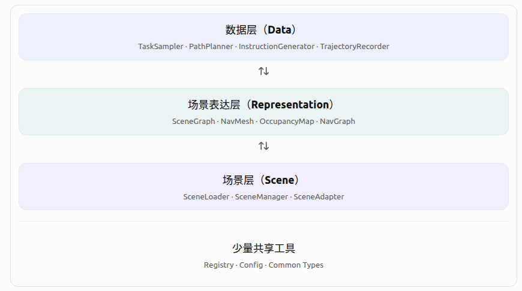
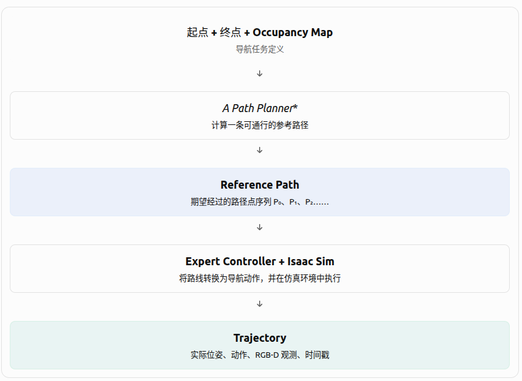

本项目拟构建一套基于 Isaac Sim 的模块化 VLN 仿真工具链，实现从三维仿真场景到导航训练数据的自动化生成。

## 目标：
1. 统一场景管理能力：支持已有 USD 场景导入，并能够接入基于资产库、LLM、3DGS 等不同方法构建的场景。

2. 多类型场景表达能力：支持从场景生成 Scene Graph、NavMesh、Occupancy Map、NavGraph 等表示，并具备新增自定义表达的能力。

3. 导航数据生成能力：基于场景及其空间、语义表达，自动生成导航任务、参考路径、自然语言指令以及专家执行轨迹。

4. 模块化扩展能力：各层保持清晰的输入输出关系，可以独立升级或替换具体算法。

5. 数据规范化能力：统一坐标系、数据结构及文件组织形式，为后续导航模型训练提供标准化数据。

整体架构


## 设计原则
1. 场景来源与场景使用解耦  
不论场景由人工搭建、资产库组合还是 3DGS 重建产生，只要能够适配成统一的场景对象，就可以被后续模块使用。
2. 场景表达的数据格式与生成方法分离  
同一种场景表达方式(如Occupancy Map)可以使用不同方法生成，但最终应遵循统一的数据结构。
...


## 1. 场景资产层
只负责场景接入和管理。不论场景从哪里来，最终都能够通过统一的 Scene 对象被下游使用。
主要功能：
- 场景加载
- 场景基本信息管理
- 场景适配

本层输入：已有USD场景文件  
本层输出：标准化的Scene对象


### 1.1. 核心数据结构
核心数据结构scene对象定义为
```
@dataclass
class Scene:
    scene_id: str # 场景唯一标识
    usd_path: str # 场景文件
    metadata: dict # 坐标系、几何等元数据
```
元数据定义为：
```
{
  "scene_id": "room_001",
  "usd_path": "scene.usd",
  "up_axis": "Z",
  "meters_per_unit": 1.0,
  "has_collision": true,
  "has_semantics": false,
  "source": "usd"
}
```

### 1.2. 核心接口
```
scene = load_scene(scene_path，meta=None)
```
根据输入类型，调用对应的 Loader 或 Adapter。
需要支持的类型包括:
- USD
- 3DGS
- ...


## 2.场景表达层
根据场景，生成导航任务所需的空间表达。初期考虑四种
| 表达 | 主要内容 | 作用 |
|---|---|---|
| Scene Graph | 场景实体、区域、语义关系 | 支持地标查询和语言生成 |
| NavMesh | 连续可通行表面 | 支持导航空间查询和路径规划 |
| Occupancy Map | 栅格占据与可通行状态 | 支持起终点采样和 A* |
| NavGraph | 离散节点与连通关系 | 支持 R2R 风格导航任务 |

### 2.1. 调用接口
```python
XXbuilder.build(scene, config)
```
- `scene`：标准化场景对象。
- `config`：算法及生成配置。
- 返回值：对应的场景表达对象

不同的场景表达可设计各自的查询接口，例如：

```python
occupancy.is_free(position)

navmesh.find_path(start, goal)

navgraph.neighbors(node_id)

scene_graph.find_objects("sofa")
```

### 2.2. 新场景表达方式的注册
场景表达具有明确的扩展需求，因此采用注册机制。
```python
BUILDERS = {}

def register(name):
    def decorator(builder_cls):
        if name in BUILDERS:
            raise ValueError(
                f"Builder already exists: {name}"
            )

        BUILDERS[name] = builder_cls
        return builder_cls

    return decorator
```

例如：

```python
@register("occupancy")
class OccupancyBuilder:
    def build(self, scene, config):
        ...
```

调用：

```python
builder = BUILDERS["occupancy"]()
result = builder.build(scene, config)
```
自定义场景表达扩展时，只需要：
1. 实现新的XXXBuilder
2. 定义该表达的数据结构
3. 在Registry中注册


### 2.3. OCCupancy Map
```python
@dataclass
class OccupancyMap:
    grid: np.ndarray
    resolution: float
    origin: tuple
    floor_z: float
```
- `0`：Free。
- `1`：Occupied。
- `255`：Unknown。
可基于Isaac Sim内置Occupancy Map功能实现。

### 2.4. 

## 3. 导航数据生成层
```text
场景 + 空间表达
        │
        ▼
    Task Sampling
        │
        ▼
    Path Planning
        │
        ▼
 Instruction Generation
        │
        ▼
  Navigation Episodes
        │
        ▼
 Expert Trajectory（可选）
        │
        ▼
    Dataset Storage
```
### 3.1. task sampling
负责生成导航任务，确定：
- 起始位置与朝向
- 目标位置或区域
- 中间位置
- ...

可实先的sampler包括：
- RandomTaskSampler
- Room-to-Room Sampler。
- ObjectGoal Sampler。
- Multi-Waypoint Sampler。
- Cross-Floor Sampler。

#### 3.1.1. 调用接口
```python
sampler = RandomTaskSampler(occupancy)
tasks = sampler.sample(count=100)
```
- 起点与终点位于可通行区域。
- 起点与终点之间存在可行路径。
- 满足基本路径距离约束。
- 支持设置随机种子。
- 能跳过不满足条件的采样结果。

### 3.2. Path Planning
负责为任务生成参考路径。
```python
planner = AStarPlanner(occupancy)

reference_path = planner.plan(
    start=task.start,
    goal=task.goal
)
```
未来可以新增 NavMeshPlanner 和 NavGraphPlanner。

### 3.3. 导航指令生成
TBD: 基于Scene Graph的生成，基于LLM的生成

### 3.4. NavigationEpisode
核心字段：

```python
@dataclass
class NavigationEpisode:
    episode_id: str
    scene_id: str
    instruction: str
    start_pose: dict
    goal: dict
    reference_path: list
```

### 3.5. Trajectory生成


```python
@dataclass
class Trajectory:
    episode_id: str
    timestamps: list
    poses: list
    actions: list
    observations: dict
```

### 3.6 数据规范化存储
LeRobot Exporter


## 场景组织
```text
workspace/
├── scenes/
│   └── room_001/
│       ├── scene.usd
│       └── scene.json
│
├── representations/
│   └── room_001/
│       ├── occupancy/
│       ├── navmesh/
│       ├── navgraph/
│       └── scene_graph/
│
└── datasets/
    └── dataset_001/
        ├── episodes.jsonl
        └── trajectories/
```